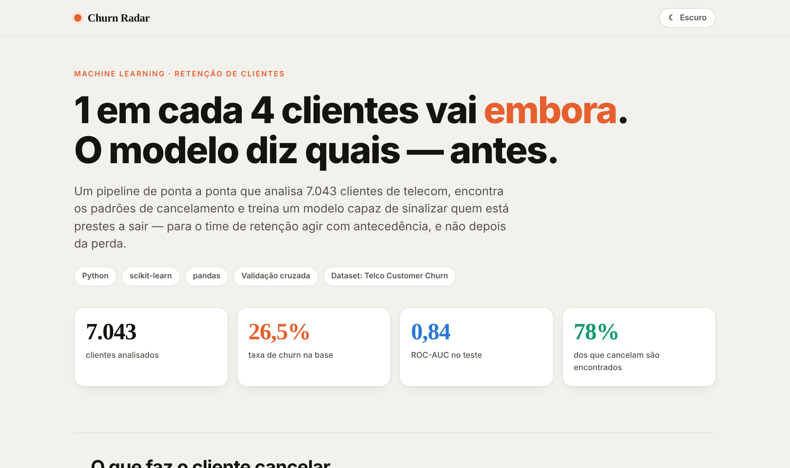
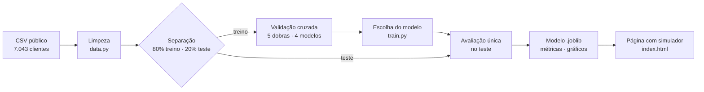
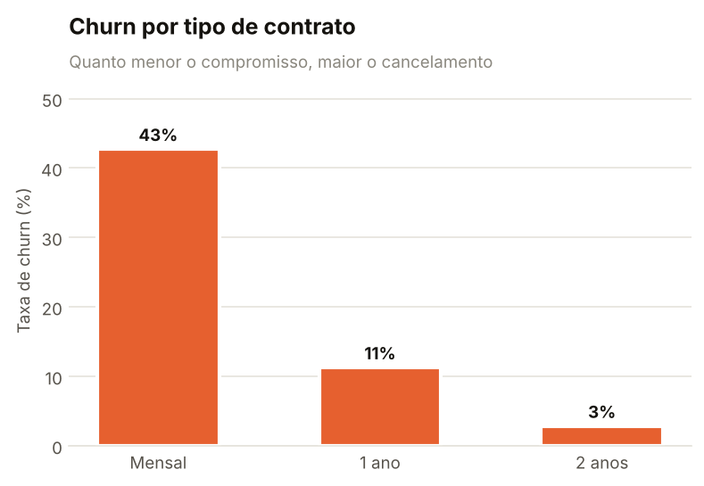
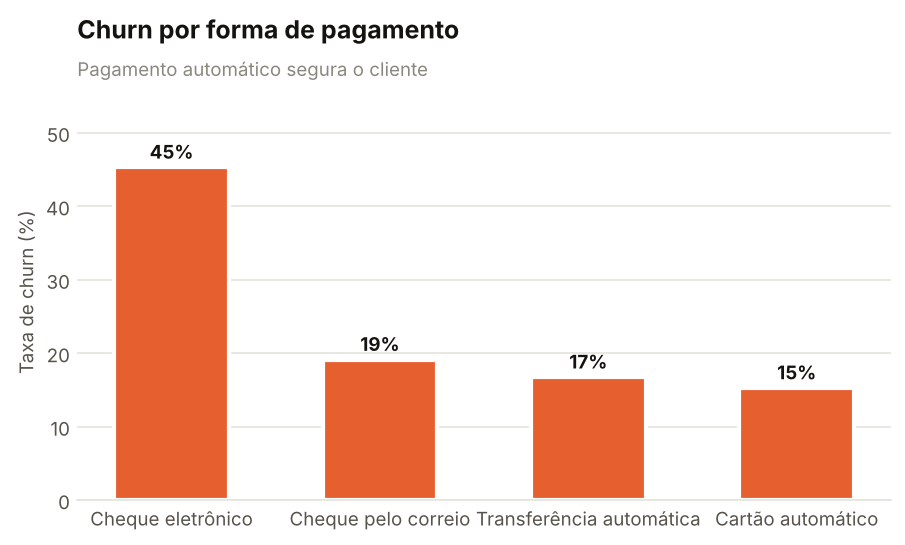
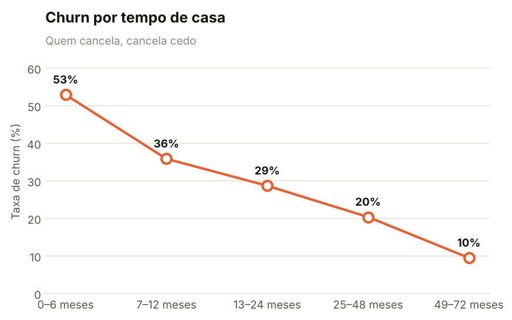
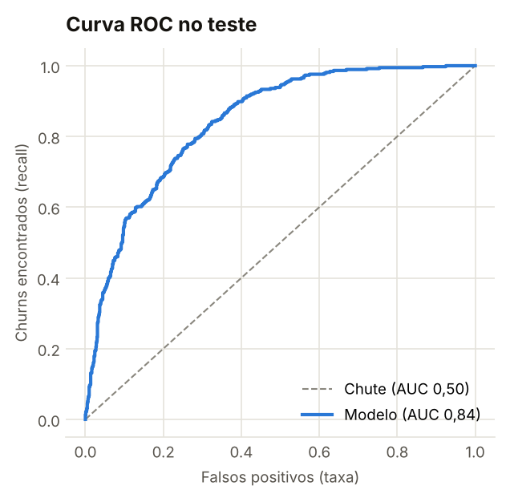
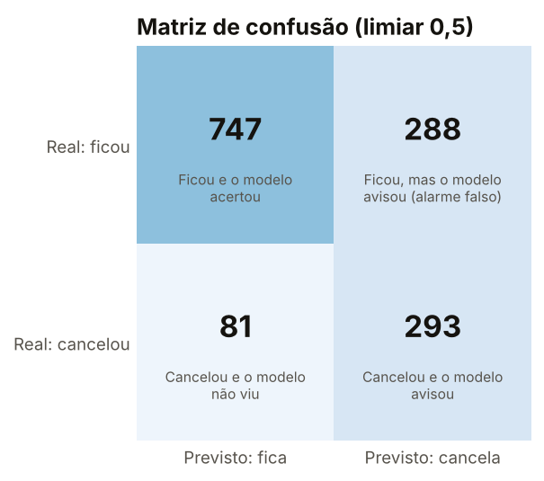
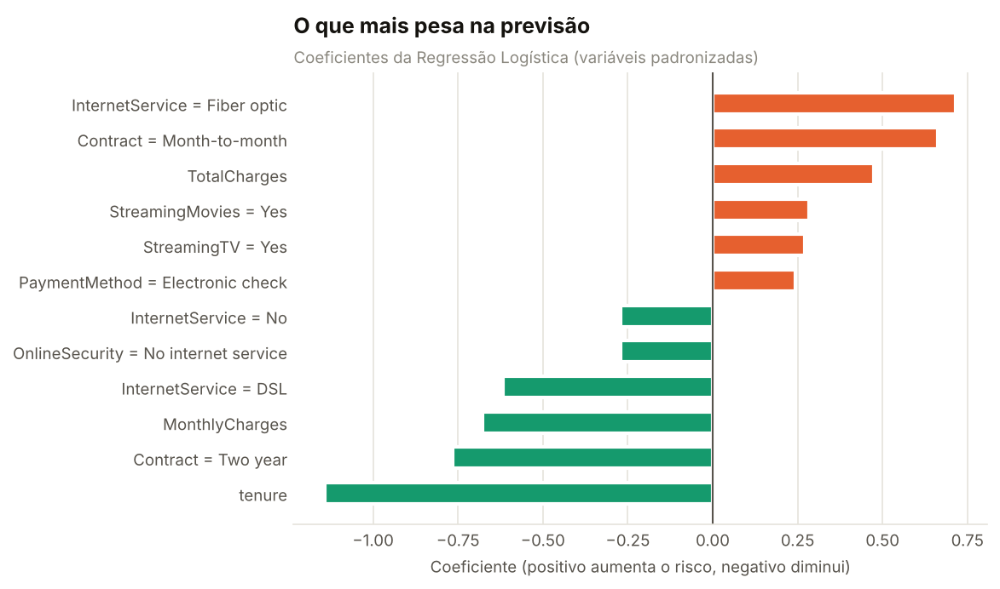

# 📉 Churn Radar · previsão de cancelamento de clientes

**Modelo de machine learning que ordena os clientes de uma operadora de telecom pelo risco de cancelar, para o time de retenção agir antes da perda.**

[](https://github.com/jgcortezi/customer-churn-prediction/actions/workflows/ci.yml)


[**▶ Página do projeto com simulador de risco**](https://jgcortezi.github.io/customer-churn-prediction/)



---

## O problema

Numa operadora de telecom, **26,5% dos clientes cancelaram** no período da base, cerca de 1 em cada 4. Reter um cliente custa menos do que conquistar outro, mas o time de retenção só consegue agir se souber **quem** está em risco.

## Resultado

| | |
|---|---|
| Clientes analisados | **7.043** (base pública *Telco Customer Churn*, IBM) |
| ROC-AUC no teste | **0,84** |
| Cancelamentos encontrados (recall) | **78%**, com limiar 0,5 |
| Precisão dos alertas | **50%** |
| Ligando só para os **20% de maior risco** | alcança **50%** de todos os que iam cancelar |

O último número é o que mais importa para o negócio: escolhendo 20% dos clientes ao acaso, o time alcançaria só 20% dos cancelamentos.

## Como eu fiz



1. **Limpeza** (`src/churn/data.py`): `TotalCharges` veio como texto, com 11 valores em branco. Todos são clientes com 0 meses de casa, que ainda não pagaram nada, então o valor certo é 0, não a média.
2. **Teste separado antes de tudo:** 20% da base, estratificada, usada uma única vez no final.
3. **Pré-processamento dentro do `Pipeline`** (`features.py`): padronização das numéricas e one-hot das categóricas. Assim nada do teste vaza para o treino, nem na validação cruzada.
4. **Comparação justa** (`models.py`, `train.py`): baseline, Regressão Logística, Random Forest e Gradient Boosting, todos com o mesmo pré-processamento e `class_weight="balanced"` para lidar com o desbalanceamento.
5. **Escolha do modelo:** o de maior ROC-AUC médio; em empate técnico, o mais simples.

### Comparação dos modelos (validação cruzada, 5 dobras, média ± desvio)

| Modelo | ROC-AUC | PR-AUC | Recall | Precisão | F1 |
|---|---|---|---|---|---|
| **Regressão Logística** ✅ | **0,846 ± 0,012** | 0,660 | 0,801 | 0,517 | 0,628 |
| Random Forest | 0,845 ± 0,009 | 0,653 | 0,762 | 0,540 | 0,632 |
| Gradient Boosting | 0,841 ± 0,009 | 0,657 | 0,769 | 0,536 | 0,631 |
| Baseline (sempre "fica") | 0,500 | 0,265 | 0,000 | 0,000 | 0,000 |

Os três modelos ficaram a menos de 0,005 de ROC-AUC entre si, menos que a variação entre as dobras. Fiquei com a **Regressão Logística**: empata com os mais complexos, treina em segundos e cada coeficiente pode ser explicado ao time de negócio. No teste, o resultado (0,842) bateu com a validação cruzada (0,846), sinal de que o modelo não decorou o treino.

## O que faz o cliente cancelar

| Contrato | Pagamento | Tempo de casa |
|---|---|---|
|  |  |  |

- **Contrato mensal** cancela 42,7%; o de 2 anos, 2,8%: cerca de **15 vezes menos**.
- **Cheque eletrônico** cancela 45,3%, quase **3 vezes** mais que cartão automático (15,2%).
- **Quem cancela, cancela cedo:** 53% nos primeiros 6 meses, menos de 10% depois de 4 anos.

| Curva ROC | Matriz de confusão | Peso das variáveis |
|---|---|---|
|  |  |  |

## Notebooks

- [`01_analise_exploratoria.ipynb`](notebooks/01_analise_exploratoria.ipynb): qualidade dos dados, taxa de churn e os fatores ligados ao cancelamento.
- [`02_modelagem.ipynb`](notebooks/02_modelagem.ipynb): comparação dos modelos, avaliação no teste, escolha do limiar e limitações.

## Como rodar

Pré-requisito: Python 3.12.

```bash
git clone https://github.com/jgcortezi/customer-churn-prediction.git
cd customer-churn-prediction
python -m venv .venv
# Windows: .venv\Scripts\activate    |    Linux/Mac: source .venv/bin/activate
pip install -r requirements-dev.txt
```

```bash
# Windows (PowerShell): $env:PYTHONPATH="src"    |    Linux/Mac: export PYTHONPATH=src
python -m churn.train                         # baixa os dados, treina, avalia e atualiza a página
python -m churn.predict exemplos/cliente.json # risco de clientes novos
pytest -q                                     # 17 testes
```

O treino baixa o CSV público automaticamente na primeira vez. Os números do README, da página e do `reports/metrics.json` saem todos do mesmo treino.

## Estrutura

```
customer-churn-prediction/
├── src/churn/
│   ├── data.py        # download, leitura e limpeza
│   ├── features.py    # pré-processamento (ColumnTransformer)
│   ├── models.py      # modelos candidatos
│   ├── train.py       # validação cruzada, escolha, teste, artefatos
│   ├── predict.py     # risco de clientes novos (função e terminal)
│   ├── simulator.py   # modelo de 6 variáveis usado na página
│   ├── plots.py       # gráficos do relatório
│   └── site.py        # escreve os números do treino no index.html
├── notebooks/         # análise exploratória e modelagem, executados
├── models/            # churn_model.joblib
├── reports/           # metrics.json e figures/
├── tests/             # 17 testes (dados, modelo, previsão, página)
├── exemplos/          # clientes de exemplo para a previsão
├── huggingface/       # modelo em formato skops e model card (python -m churn.export_hf)
├── kaggle/            # versão do notebook que roda sozinha no Kaggle
└── index.html         # página com o simulador de risco
```

## Limitações

- **O risco não é uma probabilidade calibrada.** O `class_weight="balanced"` empurra os valores para cima. O modelo é bom para **ordenar** clientes; "80%" não quer dizer que 8 em cada 10 cancelam.
- **Os sinais de variáveis muito correlacionadas não devem ser lidos sozinhos.** `MonthlyCharges` sai com sinal negativo porque a cobrança é quase a soma dos serviços, que já estão no modelo. O notebook 02 explica.
- **Base de um único período**, sem data. Em produção, o modelo precisaria ser monitorado e retreinado.
- **O simulador da página** usa um modelo menor, com as 6 variáveis que o usuário controla (ROC-AUC 0,83 no teste), para que cada coeficiente mostrado seja real.

## Próximos passos

- Calibrar as probabilidades e escolher o limiar pelo custo real de uma ação de retenção.
- Servir o modelo numa API para o CRM consultar em tempo real.
- Testar variáveis novas, como o número de serviços extras de cada cliente.

## Dados

[Telco Customer Churn](https://github.com/IBM/telco-customer-churn-on-icp4d), base pública de exemplo da IBM (licença Apache 2.0), também disponível no [Kaggle](https://www.kaggle.com/datasets/blastchar/telco-customer-churn). Os clientes são fictícios.

---

Feito por **João Gabriel Cortezi** · Engenharia da Computação (IBMR) · [GitHub](https://github.com/jgcortezi)
